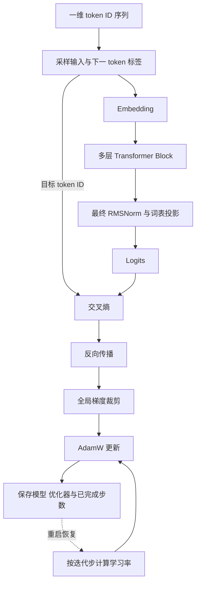

# Transformer 与训练组件复盘

这次把 [[BPE 性能分析与流式训练|BPE]] 产生的 token ID 接到了语言模型和训练组件。模型与训练组件已分阶段实现和测试，下面的流程图也用于对照下一步要组装的训练循环。

## 1. 模型前向与张量形状

| 组件 | 重点与自检 |
| --- | --- |
| Embedding 与 Linear | Embedding 把整数 token ID 查表映射到向量。Linear 的权重形状是 `(out_features, in_features)`，输入只在最后一维做投影。 |
| RMSNorm | 沿特征维取均方根并做缩放，输出保持原形状。求均值时保留特征维，便于广播。 |
| SiLU 与 SwiGLU | SiLU 是逐元素的 $x\sigma(x)$。SwiGLU 让经过 SiLU 的投影与另一条投影逐元素相乘，再投影回模型维度。 |
| Transformer Block | 两个子层各自先做 RMSNorm。注意力的残差相加结果是 FFN 的输入，FFN 输出再加回这一中间结果。 |
| Transformer LM | 从 `(B,T)` 的 token ID 得到 `(B,T,V)` 的 logits，最后一维是词表。用短于最大上下文的序列也要得到实际长度 `T` 的输出。 |

### 注意力最容易弄错的两个轴

设模型维度为 `D`，头数为 `H`，每头维度为 `D/H`。拆头后 Q、K、V 用 `(B,H,T,D/H)` 组织。SDPA 将倒数第二维视为序列维，分数的最后两维依次是 query 和 key。如果把张量排成 `(B,T,H,D/H)`，模型可能在头之间计算注意力，最后的输出形状仍能对上。

- SDPA 用 query 的特征维度平方根缩放点积，沿 **key 维**做 softmax。布尔 mask 中 `True` 表示可见。当前实现把全遮蔽的 query 行输出设为零。
- RoPE 旋转每个头的 Q 和 K，相同 token 位置使用相同的位置索引，V 保持原值。
- 因果性自检可以只改长度为 3 的序列中最后一个 token，前两个位置的输出应保持一致。

## 2. 从 logits 到参数更新

- **稳定 softmax**。沿指定维度做归一化。给这一维的所有 logits 加上同一个大常数，概率应保持一致。减去该维的最大值可避免指数溢出。
- **交叉熵**。输入是原始 logits 和目标 token ID。用 log-sum-exp 计算归一化项。若词表的所有 logits 相等，每个 token 的损失应为词表大小的自然对数。
- **AdamW**。每个有梯度的参数维护一阶矩、二阶矩和步数。更新时做偏差修正，权重衰减直接作用于参数。用同一个参数连续更新两步，可以检查状态是否累积。
- **学习率调度**。先线性 warmup，再余弦衰减，衰减结束后保持最小学习率。重点核对 warmup 结束和衰减结束两个边界，并在恢复训练时沿用相同的步数约定。
- **梯度裁剪**。在反向传播后、优化器更新前，按所有参数梯度的全局 L2 范数统一缩放。两个梯度分量分别为 3 和 4 时，全局范数为 5，可用来检查缩放是否一致。

## 3. 批次采样与训练恢复

- **批次采样**。输入和目标都应是形状 `(B,T)` 的整数张量。若采到的片段是 `[10, 11, 12, 13]` 且上下文长度为 3，输入是 `[10, 11, 12]`，目标是 `[11, 12, 13]`。长度为 `N` 的 token 序列最后一个合法起点是 `N-T-1`，因为还要留一个 token 当最后一个标签。检查索引抽样的上界是否包含了这个合法起点。
- **Checkpoint**。当前保存模型参数、优化器状态和已完成迭代步数。恢复优化器状态才能延续 AdamW 的矩估计，恢复步数才能接上学习率调度。若实验要求重启后复现完全相同的后续批次，还要考虑随机数状态。

## 4. 本次踩坑与排查顺序

| 现象 | 本次原因与排查点 |
| --- | --- |
| SDPA 报 `IndentationError` | 函数定义与函数体缩进不匹配，导致整个模型模块无法导入。先检查导入，再看测试断言。 |
| Block 报 `positional argument follows keyword argument` | RoPE 构造调用在关键字参数后又传了位置参数。统一按参数名传入后，Block 测试通过。 |
| 单独的 SiLU 测试抛出 `NotImplementedError` | SwiGLU 已能执行，单独的 `run_silu` 测试入口仍是占位。实现和测试入口要分别确认。 |
| 数据和序列化测试同时收集失败 | 两组都导入 `tests/adapters.py`，当时磁盘上的 `data.py` 缺少 `get_batch`。先确认文件已保存且函数能导入。 |
| 保存 checkpoint 的调用出现在模块顶层 | 适配器调用漏了缩进。修正后，保存操作由 `run_save_checkpoint` 触发。 |
| 直接运行测试文件报 `Permission denied` | Shell 尝试执行测试文件。用 `uv run pytest` 启动测试。 |

## 5. 验证记录与下一步

- SDPA 的 3D 和 4D 测试均通过。Block 独立测试通过。最近贴出的整组模型日志是 12 项通过、独立 SiLU 入口 1 项失败。后来已完成 SiLU，实现后的整组模型结果尚未记录。
- AdamW、学习率调度、softmax、交叉熵和梯度裁剪合跑 **5 项通过**。批次采样和 checkpoint 合跑 **2 项通过**。
- 下一步在 CPU 上接训练脚本。先确认一步训练的 loss 有限、参数会更新，再固定一个小批次观察 loss 能否下降，最后保存并重启，验证迭代步和学习率能接上。
